  
  
  

<picture><source media="(prefers-color-scheme: dark)" srcset="img/h-built-dark.svg"></picture>

  
  

<picture><source media="(prefers-color-scheme: dark)" srcset="img/h-work-dark.svg"></picture>

<picture><source media="(prefers-color-scheme: dark)" srcset="img/work-dark.svg"></picture>

Also co-founded <b>Rently</b>, freelanced on <b>Fiverr</b>, built for <b>Legal Space</b>, and led the Android track at <b>DSC JKUAT</b>.

<picture><source media="(prefers-color-scheme: dark)" srcset="img/h-adventure-dark.svg"></picture>

<b>💼 &nbsp;I'm hiring</b>

 

Great taste. I'm a full stack engineer: TypeScript, React, Node, Python, Cloudflare Workers, Postgres, BigQuery, and whatever else the problem needs. Data pipelines on the side. [Say hi](mailto:grishon.nganga01@gmail.com).

<b>🦋 &nbsp;I write Flutter, and I'm good at it</b>

 

Then I'd like to hear from you. No job post, I'm just always on the lookout for good people. Show me something you built: [grishon.nganga01@gmail.com](mailto:grishon.nganga01@gmail.com)

<b>🛠️ &nbsp;I have an idea, let's build it</b>

 

My favourite sentence. Bring the idea, I'll bring the opinions. [grishon.nganga01@gmail.com](mailto:grishon.nganga01@gmail.com)

<b>🥞 &nbsp;What even is Flapjack?</b>

 

It records your meetings, writes the notes, and hands everyone their to-dos. Less firefighting, more actually doing. [getflapjack.com](https://getflapjack.com)

<b>🛞 &nbsp;Why wheels though?</b>

 

Because cars deserve nice shoes too. Urbanlugs makes custom forged wheels. [urbanlugs.com](https://urbanlugs.com)

<b>🚗 &nbsp;Tell me a hitch-hiking story</b>

 

Oh, you've got time? This one doesn't fit in a README. [Slide into my DMs](https://x.com/GrishonNganga).

 

Limitations are perceptions. GitHub rate limits are very real though.

